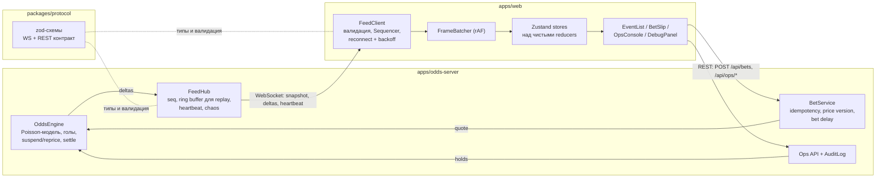
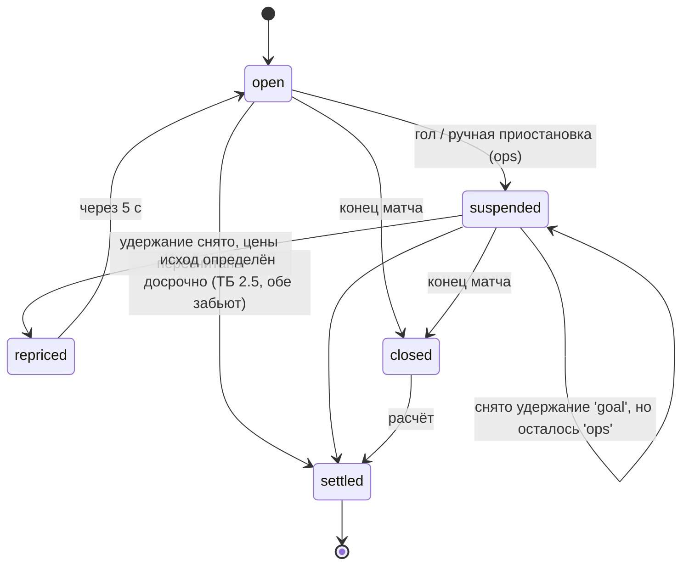

# live-betslip

Live bet slip и консоль операций с рынками поверх mock WebSocket-фида коэффициентов. Проект показывает, как фронтенд букмекера переживает высокую частоту обновлений, рассинхронизацию фида и изменение цены между кликом и подтверждением ставки.

Два интерфейса в одном приложении:

- **`#/` — лайв и купон (для игрока).** Список лайв-событий с коэффициентами по WebSocket, подсветка роста и падения цены, явные состояния рынка, одиночные ставки и экспресс, явный requote, отправка ставки через REST с idempotency key и версией цены.
- **`#/ops` — операции с рынками (внутренний инструмент).** Таблица рынков с фильтрами, подсветка аномалий (скачок цены больше X %, нет обновлений дольше N с), массовая приостановка и возобновление с обязательной причиной, журнал действий (audit trail).

**Стек:** TypeScript (strict), React 19, Vite, Zustand, zod, Node.js + `ws`, Vitest, React Testing Library, Playwright (опционально), npm workspaces, GitHub Actions.

## Быстрый старт

Нужен Node.js 22+ (проверялось на 24).

```bash
npm install
npm run dev          # odds-server на :8787 + Vite на http://127.0.0.1:5173
```

Vite проксирует `/api` и `/ws` на сервер, поэтому отдельно настраивать URL не нужно. Кнопка **Debug** в шапке открывает телеметрию и ручки chaos-режима: дубли, перестановки, потери сообщений, заморозка фида, обрыв соединения.

Проверки (то же самое запускает CI):

```bash
npm run lint
npm run typecheck
npm test
npm run build
npm run e2e          # опционально, нужен браузер Playwright (npx playwright install chromium)
```

Параметры сервера задаются переменными окружения:

| Переменная | По умолчанию | Смысл |
|---|---|---|
| `PORT` | 8787 | порт HTTP/WS |
| `EVENTS` | 12 | число одновременных событий (при 50+ видно виртуализацию списков) |
| `TICK_MS` | 500 | шаг симуляции |
| `BET_DELAY_MS` | 1200 | задержка приёма ставки в лайве |
| `GOAL_SUSPEND_MS` | 4000 | сколько рынки стоят после гола |
| `CHAOS_DUPLICATE`, `CHAOS_REORDER`, `CHAOS_GAP` | 0.02 / 0.02 / 0.002 | вероятности дубля, перестановки и потери сообщения |
| `CHAOS_DISCONNECT_MEAN_MS` | 0 | средний интервал принудительных разрывов (0 — выкл.) |
| `SEED` | 42 | seed генератора: сценарий воспроизводим |

## Архитектура



Протокол фида:

- При подключении клиент шлёт `subscribe { lastSeq }`. Если сервер ещё хранит все дельты после `lastSeq` в ring buffer, он их переигрывает. Иначе отправляет `snapshot` с текущим `seq`.
- Каждая дельта (`price`, `market_status`, `event_update`, `settle`, `event_added`, `event_removed`) несёт `seq` (на сервере без пропусков) и `ts`.
- `heartbeat` раз в секунду передаёт head `seq`. По нему клиент замечает, что потерялось последнее сообщение, даже если после него ничего не пришло.
- При разрыве последовательности, который не закрылся за окно переупорядочивания, клиент шлёт `resync` и получает snapshot.

Как клиент обрабатывает входящую дельту (`apps/web/src/feed/sequencer.ts`):

| Условие | Действие |
|---|---|
| `seq <= lastSeq` | дубль или опоздавшее сообщение: отбросить |
| `seq == lastSeq + 1` | применить и достать из буфера следующие по порядку |
| `seq > lastSeq + 1` | сложить в буфер и ждать недостающие до `gapTimeoutMs` (1 с) |
| разрыв не закрылся или буфер переполнен | `resync`, то есть запросить snapshot |

Поверх этого reducer не применяет `price`, если `priceVersion` не новее текущей. Даже при ошибке в секвенсере цена не откатится назад.

## Состояния рынка и исхода в купоне

Состояние рынка приходит с сервера. `repriced` клиент вычисляет сам: рынок открылся после приостановки с другими ценами, бейдж держится 5 с. `cash-out недоступен` — отдельный флаг, показывается рядом со статусом.



На сервере приостановки хранятся как набор удержаний (`goal`, `ops`). Автоматическое возобновление после гола снимает только `goal`: рынок, который приостановил трейдер, само по себе не откроется. Перед открытием рынок пересчитывается, и новые цены уходят в фид раньше `market_status: open`. Поэтому клиент не может увидеть открытый рынок со старыми ценами.

Исход в купоне (`apps/web/src/domain/slipLogic.ts`):

| Состояние | Когда | Можно ставить? |
|---|---|---|
| `ok` | версия цены совпадает с подтверждённой (или цена та же) | да |
| `price_up` | цена выросла | только после подтверждения; при включённом «Принимать повышение» — сразу |
| `price_down` | цена упала | только после явного «Принять новые коэффициенты» |
| `suspended` | рынок приостановлен | нет |
| `closed` / `settled` / `unavailable` | рынок закрыт, рассчитан или событие исчезло | нет, есть кнопка «Удалить недоступные» |

Отправка ставки: `pending` → `accepted`, `rejected` (`PRICE_CHANGED` открывает requote с котировками сервера) или `error` (сеть или 5xx; повтор уходит **с тем же** idempotency key).

## Ключевые решения

**Где optimistic UI безопасен, а где нет.**

- *Безопасно:* добавление и удаление исходов, суммы, режим single/экспресс, настройка «принимать повышение», фильтры и выделение в консоли. Всё это локальное состояние, сервер его не подтверждает, ошибка ничего не стоит.
- *Небезопасно — не делается:*
  - **Принятие ставки.** «Принята» показывается только по ответу сервера. Сервер проверяет версию цены дважды: при получении и после bet delay, когда цена ещё могла сдвинуться. Решает вторая проверка.
  - **Цена ставки.** Клиент никогда не подставляет новую цену сам. Исключение одно: рост цены при явно включённой настройке. Условия для игрока от этого только лучше, и сервер повторяет это правило (`acceptHigherOdds`).
  - **Массовые действия в консоли.** Статус в таблице меняется только по `market_status` из фида. REST-ответ показывает, сколько рынков затронуто и сколько пропущено и почему. Если оптимистично перекрасить строку, а сервер пропустит рынок (например, он уже рассчитан), оператор увидит неправду.
- **Приём ставок выключен**, когда фид не `live`: идёт переподключение, синхронизация или данных нет дольше 3 с (degraded mode). Пока цены на экране могут быть устаревшими, подтверждать их нельзя.

**Idempotency.** Ключ создаётся на каждую попытку ставки. Повтор после сетевой ошибки отправляет тот же ключ, и сервер вернёт уже сохранённый результат, а не примет вторую ставку. Тот же ключ с другим телом запроса получает 409. Одновременные запросы с одним ключом ждут один и тот же promise.

**Почему Zustand, а не Redux Toolkit.** На горячем пути до сотни дельт в секунду. Компоненты подписаны на одну сущность (`s.selections[id]`, `s.markets[id]`), reducers меняют только затронутые объекты, поэтому тик цены перерисовывает одну кнопку. WebSocket-клиент пишет в store вне React через `setState` раз за кадр, без actions и dispatch. Логика переходов лежит в чистых функциях (`feedReducer.ts`, `slipLogic.ts`) и тестируется без React. В RTK получилось бы то же самое, но с большим количеством церемоний и без выигрыша для этого размера.

**Производительность.** Дельты копятся в `FrameBatcher` и применяются одним `setState` на `requestAnimationFrame`. Строки и кнопки обёрнуты в `memo` и подписаны на свою сущность. При resync reducer сохраняет identity неизменившихся объектов, и snapshot не перерисовывает весь экран. Списки событий и рынков виртуализированы, если строк больше 30–40 (свой `VirtualList` с фиксированной высотой строки). Вспышка цены сделана на CSS: span перемонтируется по `key={priceVersion}`, без таймера на каждую кнопку.

**Доступность.** Навигация стрелками по сетке коэффициентов (`data-nav-row` / `data-nav-col`, выключенные кнопки пропускаются). У каждой цены есть `aria-label` с направлением изменения и состоянием рынка. Изменения цен в купоне объявляются через `aria-live="polite"`, регион вынесен за пределы сворачиваемой панели. Баннер разрыва — `role="alert"`. Учитывается `prefers-reduced-motion`. Есть skip-link «К купону». На ширине до 860 px купон превращается в bottom sheet.

**Модель цен.** Цены не случайное блуждание, а пересчёт из модели. Оставшиеся голы каждой команды распределены по Пуассону с интенсивностью λ·(90 − минута)/90. Интенсивности медленно блуждают (логнормально), голы разыгрываются из тех же λ. Из распределения итогового счёта считаются 1X2, тотал 2.5 и «обе забьют». Сверху маржа 6 % и округление вниз по сетке тиков. Поэтому цены реагируют на время и счёт правдоподобно, а скачок после гола — настоящая аномалия для консоли.

**Телеметрия** (`apps/web/src/telemetry/metrics.ts`) живёт вне React, запись метрики не вызывает рендер. Считаются WS lag (время получения минус `ts` сервера, p50/p95), сообщения в секунду, средний размер батча на кадр, переподключения, resync и snapshots, отброшенные дубли, закрытые перестановки, невалидные кадры, requote rate (доля `PRICE_CHANGED` среди попыток) и число показов requote в купоне.

## Тесты

`npm test` запускает Vitest во всех пакетах: 78 тестов.

- **Контракт.** `packages/protocol` проверяет сами схемы. `apps/odds-server/test/contract.test.ts` поднимает настоящий сервер на случайном порту и валидирует каждый WS-кадр и каждый REST-ответ по общим zod-схемам. Там же проверяются replay по `lastSeq` без snapshot и отсутствие пропусков в `seq`.
- **Сервер.** Модель цен (распределения, сетка, маржа), движок (приостановка при голе и пересчёт *до* открытия, удержание `ops` переживает автооткрытие, досрочный и финальный расчёт), BetService (идемпотентность, 409, `PRICE_CHANGED` во время bet delay, `acceptHigherOdds` только вверх, экспресс из одного события).
- **Клиент.** Sequencer, backoff, FrameBatcher, reducers, логика купона, аномалии, метрики. FeedClient на фейковом сокете и фейковых таймерах: resync по таймауту разрыва, reconnect с backoff, replay без snapshot, обрыв «молчащего» соединения.
- **Компоненты (RTL).** Вспышка и `aria-label` цены. Навигация стрелками. Requote: ставку нельзя отправить по изменившейся цене без подтверждения. `PRICE_CHANGED` от сервера. Повтор после сетевой ошибки с тем же ключом. Блокировка при разрыве. Массовая приостановка требует причину и попадает в журнал.
- **Сходимость под chaos** (`apps/web/test/convergence.integration.test.ts`). Настоящий сервер с 15 % дублей, 15 % перестановок, 2 % потерь и разрывами каждые ~0.7 с кормит настоящий FeedClient. После затишья состояние клиента совпадает со snapshot сервера до версии каждой цены.
- **E2E (опционально, не в CI).** `npm run e2e`, Playwright на desktop и Pixel 7: ставка доходит до принятия или явного отказа, массовая приостановка появляется в журнале, купон на мобильном работает как bottom sheet.

## Ограничения

- Сервер — mock. Одно событие — футбол с тремя рынками, нет лимитов по игроку, баланса, cash-out как операции (показывается только флаг доступности), авторизации и ролей в консоли (`actor` — просто поле ввода).
- Всё состояние сервера в памяти: ставки, журнал и ключи идемпотентности пропадают при перезапуске, ключи не истекают.
- WS lag и возраст рынка в консоли считаются по разнице часов клиента и сервера. Локально это корректно. Между машинами нужна оценка смещения часов, например по `serverTime` из `hello`, она не реализована.
- Одна подписка на весь фид, без подписки на отдельные события или виды спорта.
- Виртуализация рассчитана на фиксированную высоту строки: рынки события прокручиваются по горизонтали, а не переносятся.
- История действий в консоли обновляется опросом раз в 5 с, а не через фид.
- Метрики показываются только в debug-панели и никуда не отправляются.

## Как это соотносится с вакансией

Типичная вакансия frontend-инженера в sportsbook или admin platform просит React/TypeScript, real-time streams, работу с большим числом состояний, dashboards и сложные формы, внимание к производительности и интеграции с API.

- **Real-time streams:** WebSocket с seq, replay и snapshot, переупорядочивание, дедупликация, reconnect с backoff и jitter, degraded mode.
- **Сложные состояния:** open, suspended, repriced, closed, settled, cash-out unavailable показаны явно; для купона есть отдельный конечный автомат и явный requote.
- **Безопасность денег на фронте:** ставка никогда не уходит по цене, которую игрок не видел; повтор идемпотентен; приём ставок блокируется при устаревших данных.
- **Admin platform:** консоль с фильтрами, порогами аномалий, массовыми действиями с обязательной причиной и журналом.
- **Performance и accessibility:** батчинг по кадрам, подписка на уровне сущностей, виртуализация, клавиатурная навигация, aria-live, мобильная раскладка.
- **Контракт как код:** общие zod-схемы и contract-тесты между сервером и клиентом.

## Лицензия

MIT, см. [LICENSE](LICENSE).
